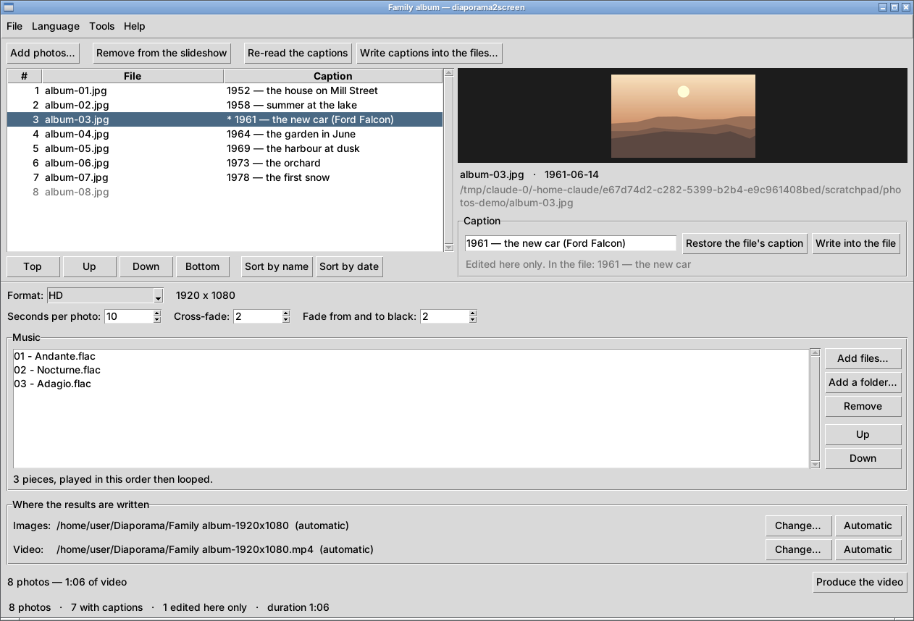

# diaporama2screen

Build a photo slideshow with the caption burnt into the image, ready to play
on a television.

**En français : [README_fr.md](README_fr.md)**

The result is a single MP4 file. A USB stick is all it takes to play it on
any modern television — no computer, no network, no particular player.



## What it does

Each photograph is laid out at the television's resolution with its caption
written in white on a black band underneath, the photographs are assembled
into a video with cross-fades and music, and the whole becomes one MP4 file.

Captions are read **from the photographs themselves** — the IPTC, XMP and
EXIF fields digiKam and other cataloguers write — never from a catalogue
database. A photograph already captioned in digiKam arrives with its caption
in place, with nothing to export.

The choosing itself is best left to digiKam, which searches by tag and by
face: put a tag on the photographs you keep, then import them here by that
tag.

Captions can also be edited for the slideshow alone, leaving the original
files untouched. Writing a caption back into a photograph is a separate,
explicit action, and the application reads the files back afterwards to
confirm it rather than trusting the exit code.

## Requirements

Python 3 with Tk, and six external programs. On a Debian-family
distribution:

```bash
sudo apt install python3-tk python3-pil python3-pil.imagetk \
  libimage-exiftool-perl imagemagick ffmpeg zenity
```

Two optional packages: `wmctrl`, so the file selectors are centred on the
application's own window, and `gettext`, needed only to rebuild the
translations.

The application checks these programs when it starts and names the ones that
are missing, with the command that installs them.

## Getting started

```bash
git clone https://github.com/lafontaj/diaporama2screen.git
cd diaporama2screen
python3 diaporama2screen.py
```

**Tools ▸ Install a launcher…** then puts an icon in the applications menu,
under Graphics, and optionally on the desktop.

Add photographs from a board of thumbnails that keeps its ticks across
folders, put them in order, check the captions, choose HD or 4K and a few
pieces of music, and press **Produce the video**.

## Documentation

The user guide covers every stage, the caption fields, what is written
where, and troubleshooting:

- [User guide](docs/guide.md)
- [Guide d'utilisation](docs/guide_fr.md) (français)

## Interface languages

English and French. The **Language** menu also offers **System language**,
which follows the session's locale. The choice is remembered, and applies to
the file selectors as well.

## Licence

MIT. See [LICENSE](LICENSE).
