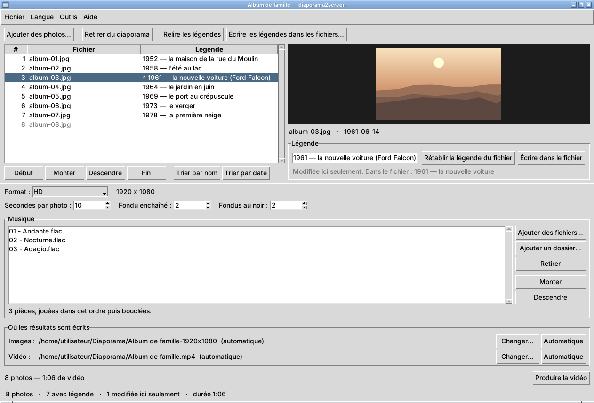

# diaporama2screen

Monter un diaporama de photographies dont la légende est incrustée dans
l'image, prêt à jouer sur un téléviseur.

**In English: [README.md](README.md)**

Le résultat est un seul fichier MP4. Une clé USB suffit à le lire sur
n'importe quel téléviseur récent, sans ordinateur, sans réseau et sans
lecteur particulier.



## Ce que fait l'application

Chaque photographie est mise en page à la résolution du téléviseur, sa
légende écrite en blanc sur un bandeau noir sous l'image ; les
photographies sont ensuite assemblées en une vidéo avec fondus et musique,
et le tout devient un seul fichier MP4.

Les légendes sont lues **dans les photographies elles-mêmes** — les champs
IPTC, XMP et EXIF que remplissent digiKam et les autres catalogueurs —
jamais dans la base de données d'un catalogue. Une photographie déjà
légendée dans digiKam arrive avec sa légende en place, sans rien exporter.

Le tri se fait d'ailleurs volontiers dans digiKam, qui cherche par
étiquette et par visage : il suffit d'y poser une étiquette sur les photos
retenues, puis de les importer ici par cette étiquette.

Une légende peut aussi être modifiée pour le diaporama seulement, sans
toucher au fichier d'origine. L'écrire dans la photographie est une action
distincte et explicite, et l'application relit ensuite les fichiers pour
confirmer le résultat au lieu de se fier au code de retour.

## Ce qu'il faut

Python 3 avec Tk, et six programmes extérieurs. Sur une distribution de la
famille Debian :

```bash
sudo apt install python3-tk python3-pil python3-pil.imagetk \
  libimage-exiftool-perl imagemagick ffmpeg zenity
```

Deux paquets facultatifs : `wmctrl`, pour que les fenêtres de sélection
soient centrées sur celle de l'application, et `gettext`, qui ne sert qu'à
refabriquer les traductions.

L'application vérifie ces programmes à son démarrage et nomme ceux qui
manquent, avec la commande qui les installe.

## Pour commencer

```bash
git clone https://github.com/lafontaj/diaporama2screen.git
cd diaporama2screen
python3 diaporama2screen.py
```

Le menu **Outils ▸ Installer un lanceur…** dépose ensuite une icône dans le
menu des applications, sous Graphisme, et au choix sur le bureau.

Ajouter des photographies depuis une planche de vignettes qui conserve les
cases cochées d'un dossier à l'autre, les mettre en ordre, vérifier les
légendes, choisir HD ou 4K et quelques morceaux de musique, puis appuyer sur
**Produire la vidéo**.

## Documentation

Le guide d'utilisation couvre chaque étape, les champs de légende, ce qui
est écrit où, et le dépannage :

- [Guide d'utilisation](docs/guide_fr.md)
- [User guide](docs/guide.md) (English)

## Langues de l'interface

Français et anglais. Le menu **Langue** offre aussi **Langue du système**,
qui suit la locale de la session. Le choix est retenu, et s'applique
également aux fenêtres de sélection de fichiers.

## Licence

MIT. Voir [LICENSE](LICENSE).
