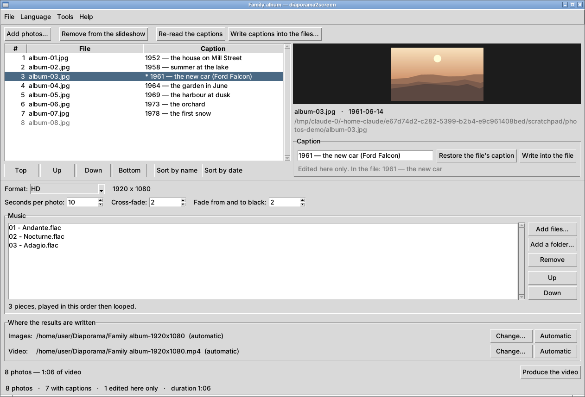

# diaporama2screen — user guide

Build a photo slideshow with the caption burnt into the image, ready to play
on a television.

The result is a single MP4 file: a USB stick is all it takes to play it on
any modern television — no computer, no network, no particular player.

The commands in this guide run in a terminal, on the computer the
application runs on. They are written for a Debian-family distribution —
Debian, Ubuntu, Linux Mint — and transpose easily elsewhere: only the
package manager changes.

---

## What the application produces

Two things, in this order.

**The laid-out images.** Each photograph is resized to the television's
resolution and its caption is written in white on a black band underneath.
The photograph keeps its proportions: whatever is missing to fill the frame
is padded with black on either side. The band takes at least a tenth of the
height, and grows when the caption is long. The text is centred, at 4 % of
the image height — 43 points in HD, 86 in 4K — in DejaVu Sans.

**The video.** The images follow one another with a cross-fade between each,
an opening from black at the start and a closing to black at the end. The
music, when there is any, is joined end to end and then looped as many times
as needed to cover the duration, with a two-second fade in and a four-second
fade out.

The encoding is H.264 at 30 frames per second in 4:2:0, with AAC sound at
192 kb/s — the format televisions, consoles and media players read.

The laid-out images are kept next to the video. They are what lets you check
a caption without re-encoding everything, and print a copy if needed.

---

## Installing what is needed

The application is written in Python and calls six external programs.

```bash
sudo apt install python3-tk python3-pil python3-pil.imagetk \
  libimage-exiftool-perl imagemagick ffmpeg zenity
```

What each one is for:

- **python3-tk** — the window itself.
- **python3-pil** and **python3-pil.imagetk** — the previews and the
  thumbnails.
- **libimage-exiftool-perl** — reading captions from the photographs, and
  writing them back.
- **imagemagick** — laying out the images with their band.
- **ffmpeg** — assembling the video and the music.
- **zenity** — the desktop's own file selectors.

Two optional packages, both worth having:

```bash
sudo apt install wmctrl gettext
```

`wmctrl` lets the application centre the file selectors on its own window;
without it, the window manager places them where it sees fit. `gettext` is
needed only to rebuild the translations.

The application checks these programs when it starts and names the ones that
are missing, together with the command that installs them. **Tools ▸
Required programs** repeats that check at any time.

---

## Getting and starting the application

The application has no installer: it is a folder of Python files that runs
where it stands.

```bash
git clone https://github.com/lafontaj/diaporama2screen.git
cd diaporama2screen
python3 diaporama2screen.py
```

So that this path need not be remembered, **Tools ▸ Install a launcher…**
puts an icon in the applications menu, under **Graphics**, and optionally on
the desktop. The launcher records where the folder sits; moving the folder
means installing it again. Cinnamon requires a launcher placed on the desktop to be marked
as trusted; the application does that itself. **Tools ▸ Remove the launcher**
undoes it.

ℹ The applications menu sometimes takes a few seconds to notice a new
launcher.

---

## The window



Four areas, from top to bottom.

**The toolbar** — add photographs, remove them, re-read the captions from
the files, write the captions into the files.

**The list** — one line per photograph, in the order they will play. Each
line carries its rank, its file name, its date and its caption. The buttons
under the list move the chosen photograph, or sort everything by name or by
date.

**The preview** — the photograph chosen in the list, with its caption below
it, open for editing.

**The settings** — format, timings, music, output folders, and the button
that starts the production.

---

## 1. Adding photographs

**Add photos…** opens a board of thumbnails.

It is browsed one folder at a time: the field at the top shows the current
folder, **Change…** picks another, and **Parent folder** moves up one level.
**Include subfolders** extends the board to everything underneath.

Each thumbnail carries a tick box and the file name. Nothing is ticked on
arrival in a folder: **Select all** and **Select none** act on the folder on
display.

The important part: **ticks survive a change of folder.** You can walk
through five albums, ticking what suits as you go, and confirm only once at
the end. A line under the board keeps count of how many photographs are
ticked in other folders. A photograph already in the slideshow appears
greyed out and cannot be ticked twice.

The formats recognised are `.jpg`, `.jpeg`, `.png`, `.tif` and `.tiff`.

Thumbnails load in the background, from the top down: the board stays usable
meanwhile, and the wheel scrolls even before everything is drawn.

---

### Importing a selection made in digiKam

digiKam searches by tag, by face, by date — which this application does not
do and does not try to. The bridge between the two is the tag.

Whoever does the choosing puts a tag on what they keep, say
"Events/Slideshow". digiKam writes it into the photographs themselves, and
**File ▸ Import from a tag…** finds them again.

The window asks for a folder, then **Look for tags** sweeps it and lists
every tag found with the number of photographs carrying it. The **Filter**
field narrows the list as it is typed, ignoring accents and case:
"evenements" finds "Événements". Ticks survive the filter, so one tag can be
ticked, something else looked up, and the next one ticked.

The first sweep of a large library takes a moment — of the order of a
minute for a few tens of thousands of photographs, depending on the disk.
What was read is then kept, with each file's size and modification time:
later sweeps read only what has changed since, and answer in under a
second. Nothing depends on it — deleting that cache costs one slow sweep,
no more.

**Add** adds the photographs of the ticked tags to the slideshow. Those
already in it are left alone: importing adds, it does not replace. The
**Replace the slideshow instead of adding to it** box is there for starting
over, and it asks for confirmation before emptying anything — which affects
the slideshow only, never the files.

Four fields are consulted, because cataloguers do not agree with one
another: `XMP:TagsList` and `XMP:HierarchicalSubject` for hierarchical tags,
`XMP:Subject` and `IPTC:Keywords` for plain keywords. digiKam usually writes
all four.

ℹ **digiKam has to write its tags into the files** for the import to see
anything — it is a setting among its metadata options. Without it the tags
stay in its database, which this application does not read.

A tag gives a set, not a sequence: the order is settled afterwards in the
list.

## 2. Captions

This is the heart of the application, and the place to understand what
happens before acting.

### Where the caption is read

The caption is read **from the photograph itself**, never from a cataloguer's
database. Three fields are consulted, in this order, and the first one that
is not empty wins:

1. `IPTC:Caption-Abstract`
2. `XMP:Description`
3. `EXIF:ImageDescription`

These are the fields digiKam fills when a caption is typed into it. A
photograph captioned in digiKam therefore arrives in the application with
its caption already in place, with nothing to export.

The date follows the same logic: `EXIF:DateTimeOriginal`, then
`EXIF:CreateDate`, then the file's modification time.

### Editing a caption

The field under the preview is open for editing. The change affects **the
slideshow only**: the original file is not written. A note under the field
then recalls what the file still holds, and **Restore the file's caption**
goes back.

This separation is deliberate. A caption that suits a slideshow shown in a
room would often make a poor permanent description of the original — and the
reverse happens too.

The bottom of the list keeps count of how many captions are edited here
only.

### Writing captions into the files

**Destructive.** This modifies the original photographs.

It never happens on its own: it has to be asked for, either for the chosen
photograph with **Write into the file**, or for all of them at once with
**Write into the files**. A confirmation appears, offering to keep a copy of
each original under the name `name_original`.

The three fields are written together, in UTF-8, so that another program
finds the caption whichever field it consults.

The outcome is not taken on trust: after writing, the application **reads
the files back** and compares. A file that kept its old caption is named,
rather than declared a success because exiftool exited without an error.

⚠ **digiKam does not notice the change by itself.** Its database keeps the
old caption until the files are read again — by running a metadata read on
the album concerned, for instance. Without that, digiKam shows the old text
and may even write it back over the new one.

### Re-reading the captions

**Re-read the captions** takes the captions from the files again. This is
what to do after captioning photographs in digiKam while a project was
already open. Captions edited inside the application are kept; only those
that came from the files are refreshed.

---

## 3. Putting the photographs in order

The order of the list is the order of the slideshow.

The buttons under the list move the chosen photograph: **Up** and **Down**
by one rank, **Top** and **Bottom** to either end. **Sort by name** and
**Sort by date** reorder everything.

Sorting by date relies on the date read from the photograph. For scans of
family albums, that date is often the date of the scan rather than the date
the picture was taken: sorting by file name is then more reliable, provided
the files were named accordingly.

---

## 4. Settings

### Format

**HD** gives 1920 × 1080, **4K** gives 3840 × 2160. The choice fixes the
resolution of the laid-out images and of the video.

4K is only worth it when the photographs have the substance to fill it. A
1200 dpi scan of a 4 × 6 inch print goes well beyond 4K and justifies it; a
photograph 1500 pixels wide will simply be enlarged, with nothing gained.

### Timings

Three settings, in seconds:

- **Seconds per photo** — 10 by default. How long a photograph holds the
  screen, fades included.
- **Cross-fade** — 2 by default. How long two photographs overlap.
- **Fade from and to black** — 2 by default. The opening at the start and
  the closing at the end.

Ten seconds feel long on a computer screen and about right on a television
watched from a distance, especially when there is a caption to read.

The total duration is shown under the list and recalculated on every change.

### Music

**Add files…** and **Add a folder…** fill the list; **Remove**, **Up** and
**Down** put it in order. The pieces are joined in the order shown, then
looped until the video ends.

The formats recognised are `.flac`, `.mp3`, `.m4a`, `.ogg`, `.opus` and
`.wav`. A file that has disappeared since it was added is marked
`(missing)` rather than being allowed to fail the production.

With no music, the video is silent.

### Where the results are written

This is the question one always asks too late, so both paths are shown
plainly.

By default the images go to `~/Diaporama/<project name>-1920x1080` and the
video to `~/Diaporama/<project name>-1920x1080.mp4`. Both carry the real
resolution, so that an HD trial and a 4K final cut need not fight over one
name.

**Change…** picks another location, **Automatic** returns to the default
calculation.

---

## 5. Producing

**Produce the video** opens a progress window with two stages: laying out
the images, then encoding the video. Each has its own progress bar, and the
log underneath receives whatever deserves mentioning — an unreadable
photograph, a caption ImageMagick refused.

**Stop** interrupts the production after a confirmation. Whatever was
already written stays on disk.

At the end, **Open the folder** shows the result in the file manager.

The images produced are named `001_name.jpg`, `002_name.jpg`, and so on.
The number carries the slideshow's order, which means they can be viewed in
the right order with any image viewer.

ℹ Numbered images from a previous production are deleted before new ones are
written. Without that, a photograph removed from the project would stay in
the folder and come back in the video.

---

## The project file

**File ▸ Save** writes a `.d2s.json` file, by default in
`~/Diaporama/projets`.

It holds the list of photographs — their paths, not their contents —, the
captions edited inside the application, the order, and every setting. It
holds no image: it is a cutting sheet, not an archive. Moving the original
photographs after saving a project makes it inoperative, and the application
then reports the files it cannot find rather than refusing to open.

A project changed and not saved raises a question on closing, with the
choice of saving, not saving, or staying.

---

## Where the files live

| What | Where |
|---|---|
| Application settings | `~/.config/diaporama2screen/settings.json` |
| Thumbnail cache | `~/.cache/diaporama2screen` |
| Projects | `~/Diaporama/projets` |
| Laid-out images | `~/Diaporama/<project>-<width>x<height>` |
| Videos | `~/Diaporama/<project>-<width>x<height>.mp4` |

Nothing is written anywhere else, and none of these destinations is
compulsory: the last two are chosen project by project.

---

## Playing the slideshow on a television

Copy the MP4 to the root of a USB stick formatted as FAT32 or exFAT, plug
the stick into the television, and choose the USB source.

The MP4 carries the `+faststart` flag, which puts the playback index at the
start of the file. Televisions' own players therefore begin playing straight
away instead of reading through the whole file first.

For a showing in a public room, two precautions are worth the trouble: test
on a screen of comparable size, because a caption that reads well on a
monitor can be too small on a large screen seen from a distance; and bring a
second stick.

---

## Troubleshooting

**“Some required programs are missing”** — the list names the programs and
the command that installs them. **Tools ▸ Required programs** repeats the
check.

**A photograph does not appear in the preview** — the format may be
recognised by its extension but not readable, for instance a TIFF with an
unusual compression. The production log reports it and carries on without
it.

**“Caption unusable”** in the log — ImageMagick refused to compose the text.
The photograph is still laid out, without its band. A caption holding very
unusual characters is the most common cause.

**The video is silent although music was chosen** — check that the files are
not marked `(missing)` in the list.

**The production fails without a clear message** — start the application
from a terminal with the command in “Getting and starting the application”: ffmpeg's and
ImageMagick's own messages appear there in full.

**digiKam still shows the old caption** — have it read the album's metadata
again, as explained above.

**Reporting a fault** — quote the version number, without which the report
is hard to place. It appears in **Help ▸ About**, and on the command line:

```bash
python3 diaporama2screen.py --version
```

---

## Changing the language

The **Language** menu offers French, English and **System language**, which
follows the session's locale. The choice is remembered from one start to the
next, and applies to the file selectors as well.

After the interface texts change, the catalogues are rebuilt with one
command.

```bash
cd diaporama2screen
./build_locales.sh
```

The script extracts the strings from the `.py` files, fills the French
catalogue, reports the ones with no translation, and compiles the result.
The compiled files are not kept under version control: they are rebuilt with
this same command.
